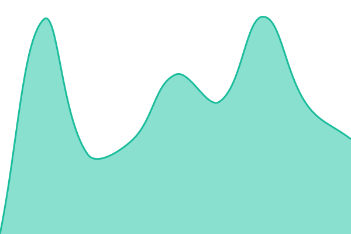
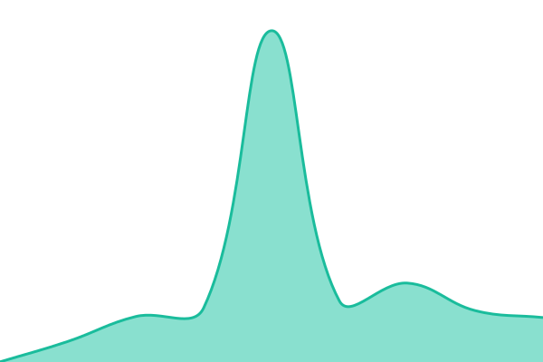
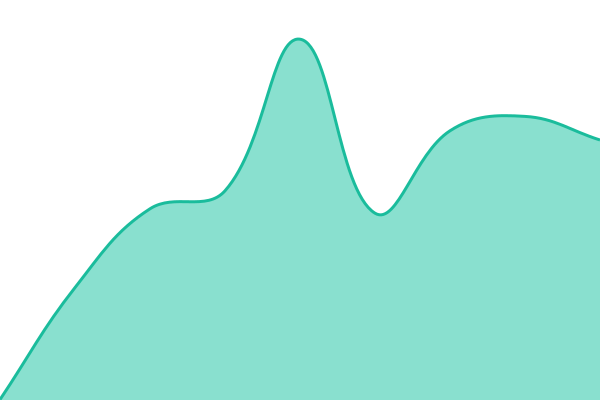

# [📈 Live Status](https://status.e4t.top): <!--live status--> **🟩 All systems operational**

This repository contains the open-source uptime monitor and status page for [12tae12](1t2.pages.dev), powered by [Upptime](https://github.com/upptime/upptime).

With [Upptime](https://upptime.js.org), you can get your own unlimited and free uptime monitor and status page, powered entirely by a GitHub repository. We use [Issues](https://github.com/12tae12/status/issues) as incident reports, [Actions](https://github.com/12tae12/status/actions) as uptime monitors, and [Pages](https://status.e4t.top) for the status page.

<!--start: status pages-->
<!-- This summary is generated by Upptime (https://github.com/upptime/upptime) -->
<!-- Do not edit this manually, your changes will be overwritten -->
<!-- prettier-ignore -->
| URL | Status | History | Response Time | Uptime |
| --- | ------ | ------- | ------------- | ------ |
|  [Main Website](https://www.e4t.top) | 🟩 Up | [main-website.yml](https://github.com/12tae12/status/commits/HEAD/history/main-website.yml) | 

 693ms
     
 | 

<a href="https://status.e4t.top/history/main-website">100.00%</a>
    

|  [Topshort](https://e4t.top/topshort) | 🟩 Up | [topshort.yml](https://github.com/12tae12/status/commits/HEAD/history/topshort.yml) | 

 479ms
     
 | 

<a href="https://status.e4t.top/history/topshort">100.00%</a>
    

|  [Matrix](https://matrix.e4t.top) | 🟩 Up | [matrix.yml](https://github.com/12tae12/status/commits/HEAD/history/matrix.yml) | 

 593ms
     
 | 

<a href="https://status.e4t.top/history/matrix">100.00%</a>
    

|  [Jellyfin](https://jellyfin.e4t.top) | 🟩 Up | [jellyfin.yml](https://github.com/12tae12/status/commits/HEAD/history/jellyfin.yml) | 

 585ms
     
 | 

<a href="https://status.e4t.top/history/jellyfin">100.00%</a>
    

|  [4get](https://4get.e4t.top) | 🟩 Up | [4get.yml](https://github.com/12tae12/status/commits/HEAD/history/4get.yml) | 

 279ms
     
 | 

<a href="https://status.e4t.top/history/4get">100.00%</a>
    

|  [Nextcloud](https://nextcloud.e4t.top) | 🟩 Up | [nextcloud.yml](https://github.com/12tae12/status/commits/HEAD/history/nextcloud.yml) | 

 771ms
     
 | 

<a href="https://status.e4t.top/history/nextcloud">100.00%</a>
    

|  [Telemetry](https://telemetry.e4t.top) | 🟩 Up | [telemetry.yml](https://github.com/12tae12/status/commits/HEAD/history/telemetry.yml) | 

 322ms
     
 | 

<a href="https://status.e4t.top/history/telemetry">100.00%</a>
    

<!--end: status pages-->

[**Visit our status website →**](https://status.e4t.top)

## 📄 License

- Powered by: [Upptime](https://github.com/upptime/upptime)
- Code: [MIT](./LICENSE) © [Anand Chowdhary](https://anandchowdhary.com)
- Data in the `./history` directory: [Open Database License](https://opendatacommons.org/licenses/odbl/1-0/)

This should be at [12Tae12 Status Page](https://e4t.top)
